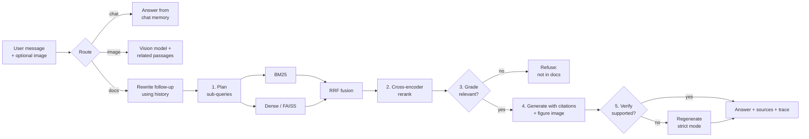

# 🧠 DocuMind — Multimodal Agentic RAG Chat Assistant

Chat with your documents, **figures and tables included**, and get **grounded answers with citations**. DocuMind remembers the conversation, understands follow-up questions, accepts image uploads, and uses an *agentic* retrieval pipeline (query planning, hybrid search, reranking, corrective retrieval and self-verification). Built entirely on **open-source models** that run on a **free Colab T4 GPU**. No paid APIs, no keys.

---

## ✨ Features

- **Multimodal ingestion**: pages with figures/tables are rendered and described by a vision-language model (Qwen2.5-VL); descriptions are searchable and linked to their image
- **Multimodal answers**: when a figure is retrieved, the model *looks at the figure image* while answering, and the UI shows it
- **Image upload**: attach a chart, diagram or photo and ask about it; it gets linked to related passages in your documents
- **Conversational memory**: follow-ups like "how many did they use?" are rewritten into standalone questions; chat history persists to a file or Google Drive
- **Intent routing**: small talk and questions about the conversation are answered from memory, document questions go through the agent
- **Query planning**: the LLM decomposes complex questions into focused sub-queries
- **Hybrid search**: BM25 (keywords) + dense vectors (meaning), merged with Reciprocal Rank Fusion
- **Cross-encoder reranking** for precise final ordering
- **Corrective RAG**: irrelevant passages are filtered out; the system **refuses** instead of hallucinating when nothing relevant exists
- **Inline citations** `[1][2]` linked to source file + page number
- **Self-verification**: the answer is fact-checked against its sources and regenerated if unsupported
- **Evaluation suite**: synthetic single-hop and multi-hop test sets, retrieval benchmark (hit@5, MRR), a 3-way ablation (naive vs hybrid vs agentic RAG) with LLM-as-judge, context recall, and an out-of-scope refusal test
- **Transparent agent trace** showing every decision
- **Gradio web app** with document upload and a public share link

## 🏗️ Architecture

## 🧰 Tech stack (all free & open-source)

| Component | Choice | Why |
|---|---|---|
| LLM + vision | `Qwen/Qwen2.5-VL-3B-Instruct` (fp16) | One model for text *and* images, fits a free T4 (~7.5 GB) |
| PDF parsing | PyMuPDF | Text extraction + page rendering for figures |
| Embeddings | `BAAI/bge-small-en-v1.5` | Top-tier small embedding model, fast |
| Reranker | `cross-encoder/ms-marco-MiniLM-L-6-v2` | Tiny, big precision gain |
| Vector store | FAISS | In-memory, zero setup |
| Keyword search | `rank_bm25` | Catches exact terms that vectors miss |
| UI | Gradio | Shareable public link from Colab |
| Compute | Google Colab free T4 | ₹0 / $0 |

No LangChain/LlamaIndex: the pipeline is written from scratch so every step is understandable and the notebook doesn't break when frameworks change.

## 📊 Results

**Retrieval** (15 LLM-generated questions over the two sample papers, k = 5)

| retriever | hit@5 | MRR |
|---|---|---|
| BM25 (keywords) | 0.800 | 0.619 |
| dense (vectors) | 0.667 | 0.556 |
| hybrid (RRF) | 0.800 | 0.660 |
| **hybrid + rerank** | **0.933** | **0.867** |

Hybrid search plus reranking finds the right passage for **93%** of questions vs **67%** for vector-only search, and ranks it much higher (MRR 0.87 vs 0.56).

**Answer quality** (6 questions, LLM-as-judge 1–5): the agentic pipeline and naive RAG tied on faithfulness and correctness (4.33 each), with the agent ~2× slower. On these simple single-fact questions, the main gain comes from better retrieval; the agent steps add **safe refusals** (out-of-scope questions get "not in the documents" instead of an invented answer). An extended benchmark (multi-hop questions, context recall, refusal rate) is built into section 9 of the notebook.

## 🚀 Run it

1. Click **Open in Colab** above
2. **Runtime → Change runtime type → T4 GPU**
3. **Runtime → Run all** (~5–10 min first time)
4. Open the `gradio.live` link printed in section 8 and start chatting
5. Optional: set `RUN_EVAL = True` in section 9 to run the benchmark (~15 min)

**On Kaggle instead:** New Notebook → File → Import Notebook → Session options: *GPU T4 x2*, *Internet on* → Run All.

## 🧠 Design decisions

- **Small, focused LLM calls instead of one big prompt**: makes a 3B model reliable enough for multi-step agent behaviour.
- **Robust JSON parsing with safe fallbacks**: if the model returns malformed output, the pipeline degrades gracefully instead of crashing.
- **Rerank against the original question**, not sub-queries, so the final context stays on-topic.
- **Refusal path** uses both the LLM grader and the reranker score, balancing hallucination prevention against over-refusal.
- **Per-passage yes/no grading**: v1 asked the 3B model to pick relevant passages from a numbered list, and it rejected everything. Switching to one yes/no judgement per passage fixed it, a good example of shaping tasks to what small models do well.
- **Describe figures once, at ingestion**: vision calls are slow, so figure descriptions are cached and indexed like text; the image itself is only re-read when that figure is actually used in an answer.
- **Condense before retrieving**: search engines don't understand "they" or "that figure", so follow-ups are rewritten into standalone questions first.
- **Ablation, not just a demo**: comparing naive → hybrid → agentic separates the gain from better retrieval from the gain from agent steps.

## ⚠️ Limitations (honest notes)

- The same model generates, grades and judges, so the LLM-as-judge scores may be biased. A stronger, independent judge would be better.
- The synthetic test set is small (~12 single-hop + 6 multi-hop questions) and gold labels are single chunks, so neighbouring chunks containing the answer count as misses.
- Refusal is detected with a keyword pattern, which can miss unusual phrasings.
- Scanned PDFs need OCR (not included).
- Figure detection relies on captions ("Figure 1:", "Table 2:") or large embedded images; uncaptioned vector drawings can be missed.
- Each chat turn makes ~8 model calls, so answers take ~15–30 s on a T4.
- The agentic pipeline is slower than naive RAG (several LLM calls per question).

## 🔭 Future work

- Add an OCR step and table extraction
- Stronger independent judge model; human-labelled eval set
- Streaming responses; quantised larger model (7B in 4-bit)
- Deploy to Hugging Face Spaces

## 📄 License

MIT
